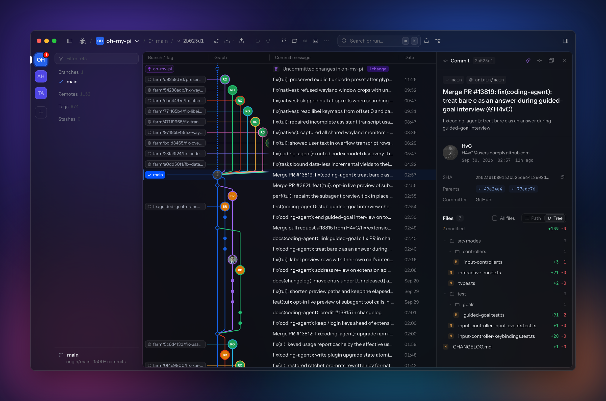

# Ahtapot

**A macOS git client with a commit graph, line-by-line staging and undo for git actions.**

 

---

Ahtapot, Turkish for octopus, is a git client for macOS. It draws every branch, remote and tag in
one commit graph and stages changes down to single lines. ⌘Z undoes commits, rebases, resets and
discards. It runs your installed `git`, so your config, hooks and credential helpers apply.

## Features

- **Commit graph.** Every branch, remote and tag, paged 1,500 commits at a time. Jumping to an
  older commit, from a parent link or a search result, loads history down to it.
- **Staging.** Stage by file, hunk or line. Click a `+` or `-` line in the diff gutter to pick it,
  ⇧-click for a range.
- **History operations.** Merge, rebase, cherry-pick, revert and reset from the branch and commit
  context menus.
- **Conflicts.** When an operation stops on conflicts, the changes panel shows Continue, Skip and
  Abort. Each conflicted file opens in a resolver with Accept current, incoming or both per block.
- **Branches, tags and remotes.** Create, rename, delete, push, force push with lease and delete on
  the remote. Tags are annotated when given a message. Remotes can be added, fetched and removed.
- **Undo.** ⌘Z and ⇧⌘Z undo and redo commits, checkouts, merges, rebases, resets, stashes and
  discards of files, hunks or lines. The history survives restarts.
- **Terminal.** A terminal per repository, toggled with ⌘J.
- **Command palette.** ⌘K searches the whole history.
- **AI explanations.** Streams an explanation of a commit's diff from Anthropic, OpenAI,
  OpenRouter, Gemini, Groq, Ollama, LM Studio or a custom endpoint.
- **Appearance.** Accent colors, window tint, fonts, row density, saved loadouts and eight Dock
  icon styles.
- **Updates.** Checks the latest release at launch and installs it after you confirm.

## Install

Download the `.dmg` from the [latest release](https://github.com/bubabi/ahtapot/releases/latest).
Builds are for Apple Silicon Macs.

Drop a folder on the window to add it as a repository.

## How it works

Ahtapot is a Tauri app. The interface is React, rendered in the macOS system webview. A Rust
backend runs `git`, watches the repository for changes and hosts the terminal sessions. The
interface calls the backend over Tauri's IPC. The app bundle is 7.5 MiB.

## Stack

- Tauri 2 with a Rust backend: portable-pty for the terminal, notify for file watching, ureq for
  AI and GitHub requests
- React 19, TypeScript, Vite and Zustand, with xterm.js for the terminal and Prism for syntax
  highlighting

## Credits

The interface is modeled on a git client prototype that [Can Bölük](https://x.com/_can1357) shared
[on X](https://x.com/_can1357/status/2104776336212377950).

## License

MIT. See [LICENSE](LICENSE).
